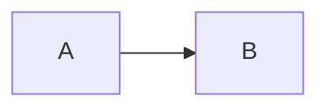

# 📖 MD Reader Pro

Trình đọc Markdown đẹp với giao diện như Claude — đầy đủ tính năng productivity.

## ✨ Tính năng

| Nhóm | Tính năng |
|------|-----------|
| **Đọc** | Render Markdown đẹp · Mục lục tự động · Tìm kiếm · Focus mode · 3 chủ đề (Sáng/Tối/Sepia) |
| **Productivity** | Tabs nhiều file · File gần đây (lịch sử 12 file) · Edit Mode (split view với preview) |
| **Markdown nâng cao** | Mermaid diagrams · KaTeX công thức toán · Code highlight · Collapsible code blocks |
| **Cá nhân hóa** | 6 fonts · Cỡ chữ · Khoảng cách dòng · Độ rộng cột |
| **Dịch thuật** | Dịch đoạn chọn hoặc tài liệu hiện tại bằng Google Translate miễn phí |
| **Đọc to** | TTS đa nguồn: Web Speech (giọng hệ thống) · VieNeu-TTS (tiếng Việt, offline, chỉ bản .exe) · Tốc độ điều chỉnh |
| **Nhập file** | DOCX · DOC · XLSX · XLS · PPTX · PDF · HTML · ảnh (OCR) → Markdown (chỉ bản .exe) |
| **Xuất file** | TXT · DOCX · PDF |
| **PWA** | Cài như app · Hoạt động offline · Icon riêng |

## 🚀 Cách sử dụng

### Cách 1: Mở nhanh (không cần cài đặt)
Chỉ cần mở file `index.html` trong trình duyệt — mọi tính năng đều hoạt động **trừ** PWA install và offline.

### Cách 2: Chạy local server (đầy đủ tính năng PWA)

**Python:**
```bash
cd md-reader-pro
python3 -m http.server 8000
# Mở: http://localhost:8000
```

**Node.js:**
```bash
npx serve md-reader-pro
```

**PHP:**
```bash
cd md-reader-pro
php -S localhost:8000
```

Sau đó truy cập `http://localhost:8000` — trình duyệt sẽ hiển thị nút **"Cài đặt app"** để cài lên desktop/mobile.

### Cách 3: Deploy lên hosting miễn phí
- **GitHub Pages**: push folder lên repo, bật Pages
- **Netlify**: kéo thả folder vào netlify.app
- **Vercel**: `vercel deploy` trong folder
- **Cloudflare Pages**: connect repo

Sau khi deploy với HTTPS, PWA sẽ tự động kích hoạt — người dùng có thể cài app từ trình duyệt.

## ⌨️ Phím tắt

| Phím | Tác dụng |
|------|----------|
| `Ctrl + O` | Mở file |
| `Ctrl + N` | Tab mới |
| `Ctrl + W` | Đóng tab |
| `Ctrl + E` | Vào/Thoát Edit Mode |
| `Ctrl + S` | Lưu file đang sửa |
| `Ctrl + F` | Tìm kiếm trong tài liệu |
| `Ctrl + Shift + T` | Dịch bằng Google Translate |
| `Ctrl + Tab` | Chuyển tab tiếp theo |
| `Esc` | Đóng panel hiện tại |

## 📁 Cấu trúc file

```
md-reader-pro/
├── index.html      # Ứng dụng chính
├── manifest.json   # Cấu hình PWA
├── sw.js           # Service worker (offline)
├── icon.svg        # Icon vector
├── icon-192.png    # Icon 192×192 (Android)
├── icon-512.png    # Icon 512×512 (splash screen)
└── README.md       # File này
```

## 🎯 Mẹo dùng nâng cao

**Mermaid:** Viết sơ đồ trong code block với ngôn ngữ `mermaid`:
````

````

**KaTeX:** Dùng `$...$` cho inline và `$$...$$` cho display:
```
Inline: $E = mc^2$
Display: $$\int_0^\infty e^{-x^2} dx = \frac{\sqrt{\pi}}{2}$$
```

**Google Dịch:** Bôi đen một đoạn rồi bấm nút 🌐 trên thanh công cụ hoặc nhấn `Ctrl + Shift + T`. Nếu không bôi đen, app sẽ gửi nội dung tài liệu hiện tại sang Google Translate trong tab mới. Có thể đổi ngôn ngữ đích trong ⚙️ Cài đặt → **🌐 Google Dịch**.

> ℹ️ Tính năng này không dùng API key và không tốn chi phí. Vì Google Translate nhận nội dung qua URL, tài liệu quá dài sẽ chỉ gửi phần đầu để tránh vượt giới hạn URL của trình duyệt.

**TTS:** Bấm 🔊 trên thanh công cụ, chọn nguồn (Web Speech hoặc VieNeu TTS), chọn giọng và bấm Play.

> ℹ️ **Web Speech** dùng giọng có sẵn của hệ điều hành, không cần cài thêm.
>
> ℹ️ **VieNeu TTS** chỉ có trong bản .exe, chạy offline qua Python. Cần cài trước: `py -3.14 -m venv %LOCALAPPDATA%\MDReaderPro\venv` rồi `%LOCALAPPDATA%\MDReaderPro\venv\Scripts\pip install vieneu`. Lần đầu dùng cần mạng để tải model (~900 MB). Có thể chỉ định Python khác bằng biến môi trường `MDR_PYTHON`.
>
> ℹ️ **Chạy VieNeu trên GPU NVIDIA (tùy chọn):** bản exe dùng chung venv ở trên, nên chỉ cần cài thêm vào venv đó (cần build lại exe một lần để nhận `tts_vienieu.py` mới):
> ```
> %LOCALAPPDATA%\MDReaderPro\venv\Scripts\pip install torch==2.9.1 torchaudio==2.9.1 --index-url https://download.pytorch.org/whl/cu128
> %LOCALAPPDATA%\MDReaderPro\venv\Scripts\pip install transformers safetensors
> ```
> Dung lượng tải khoảng 3 GB. Biến môi trường `MDR_VIENEU_DEVICE` chọn thiết bị: `auto` (mặc định, dùng GPU nếu có PyTorch CUDA), `cuda` hoặc `cpu`. Nếu nạp GPU lỗi (thiếu VRAM, thiếu thư viện), app tự chuyển sang CPU. Thiết bị đang dùng được ghi ở stderr dòng `VIENEU_BACKEND:`.

**OCR (PDF scan và ảnh):** engine chính là Tesseract (tesseract.js, model `vie` đi kèm trong `tessdata/`), không cần cài thêm và đọc đúng dấu tiếng Việt. PaddleOCR chỉ là dự phòng nếu Tesseract lỗi; phần dưới nói về PaddleOCR. Cài PaddleOCR một lần (tùy chọn):
```
py -3.12 -m venv %LOCALAPPDATA%\MDReaderPro\ocr-venv
%LOCALAPPDATA%\MDReaderPro\ocr-venv\Scripts\pip install paddlepaddle paddleocr pypdfium2
```
Trang PDF có ít hơn 20 ký tự chữ được OCR tự động; ảnh (png, jpg, bmp, webp, tiff) cũng nhập được qua nút "Nhập file" hoặc kéo thả. Lần đầu chạy cần mạng để tải model. Biến môi trường: `MDR_OCR_PYTHON` (đổi Python), `MDR_OCR_LANG` (mặc định `vi`), `MDR_OCR_VERSION` (`PP-OCRv3`, `PP-OCRv5`, `PP-OCRv6`). Chạy trên CPU, khoảng 10–25 giây mỗi lần khởi động.

**PPTX:** nhập `.pptx` (bản .exe) sẽ tạo mỗi slide một mục `## Slide N: tiêu đề`, đoạn đầu là tiêu đề, các đoạn sau là gạch đầu dòng. Có xử lý bảng, ghi chú slide và chữ trong nhóm hình (chỉ thử với file tự tạo, chưa thử với file PowerPoint thật). `.doc` và `.xls` cũ cũng nhập được, xem giới hạn bên dưới.

> ⚠️ **Giới hạn:** PaddleOCR (bản dự phòng) bỏ một số chữ có dấu nặng/hỏi (ví dụ "bạn" thành "bn"); Tesseract không bị lỗi này trên ảnh thử. Chỉ thử với ảnh và PDF scan tự tạo, nên vẫn cần đọc lại kết quả với tài liệu thật.
>
> `.doc` cũ chỉ lấy chữ (word-extractor), `.xls` cũ đọc bằng SheetJS với cùng giới hạn dòng như `.xlsx`.

**Tải âm thanh (WAV):** khi dùng VieNeu TTS trong bản .exe, nút ⬇ trên thanh TTS đọc toàn bộ tab đang mở, ghép các câu (cách nhau 0,2 giây) thành một file WAV mono 16-bit 48 kHz và lưu qua hộp thoại Save As. Thời gian tạo file bằng thời gian VieNeu đọc từng câu, tiến độ hiện dạng `⏳ i/n`. File được lấy mẫu lại về 48 kHz, nên không tốt hơn chất lượng gốc của model. Chưa thử với văn bản dài trên GPU 4 GB.

**Bản portable:** `npm run dist` tạo hai file trong `release/`: bản cài `MD Reader Pro Setup 1.0.0.exe` và bản portable `MD Reader Pro 1.0.0.exe` (chạy trực tiếp, không cần cài). Cả hai chưa ký số nên Windows SmartScreen có thể cảnh báo. Python, `vieneu` và PaddleOCR không nằm trong gói, cần cài riêng như hướng dẫn ở trên.

**Công thức toán:** `$...$` và `$$...$$` được cất ra khỏi trình phân tích Markdown trước khi render để `marked` không làm mất dấu `\` hay đổi `_`, `^` thành in nghiêng. Bỏ qua code block và inline code. Ví dụ `$5 đến $10` không bị coi là công thức.

**Lưu trữ:** Cài đặt và lịch sử file lưu trong `localStorage` của trình duyệt — không gửi lên server.

## 🛠 Công nghệ

- Vanilla JavaScript (không framework)
- [marked](https://marked.js.org/) — Markdown parser
- [highlight.js](https://highlightjs.org/) — Code syntax highlighting
- [Mermaid](https://mermaid.js.org/) — Diagram rendering
- [KaTeX](https://katex.org/) — Math typesetting
- [JSZip](https://stuk.github.io/jszip/) — DOCX export
- Web Speech API + [VieNeu-TTS](https://github.com/pnnbao97/VieNeu-TTS) — TTS
- Electron, mammoth, exceljs, pdfjs-dist, turndown — bản .exe và nhập file

---

Tạo bởi MD Reader Pro · Made with ❤️ for Vietnamese readers
